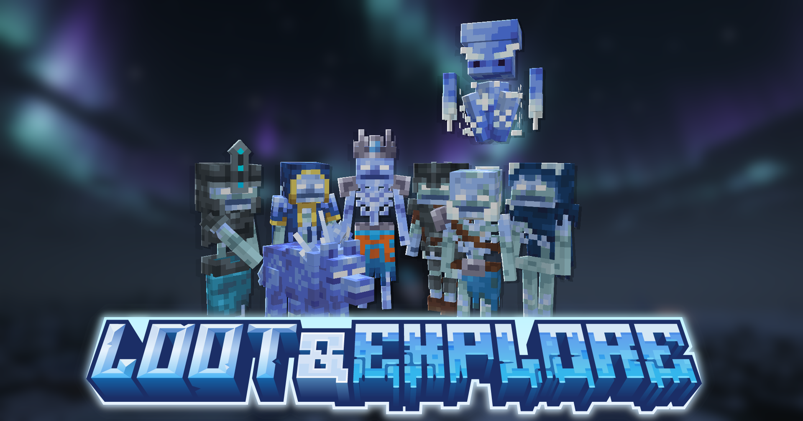
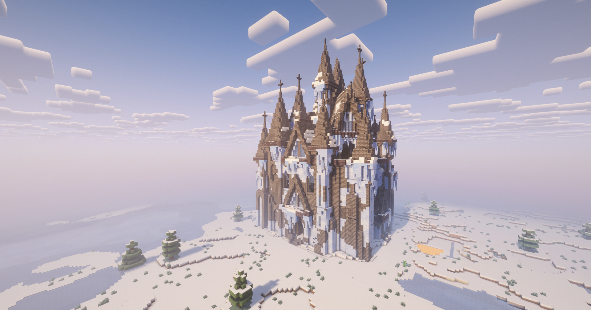
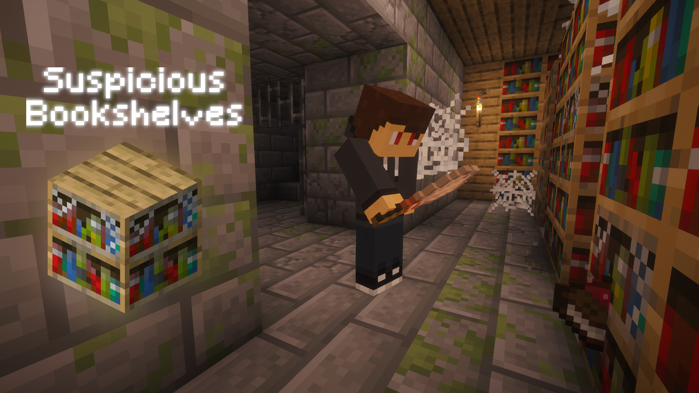
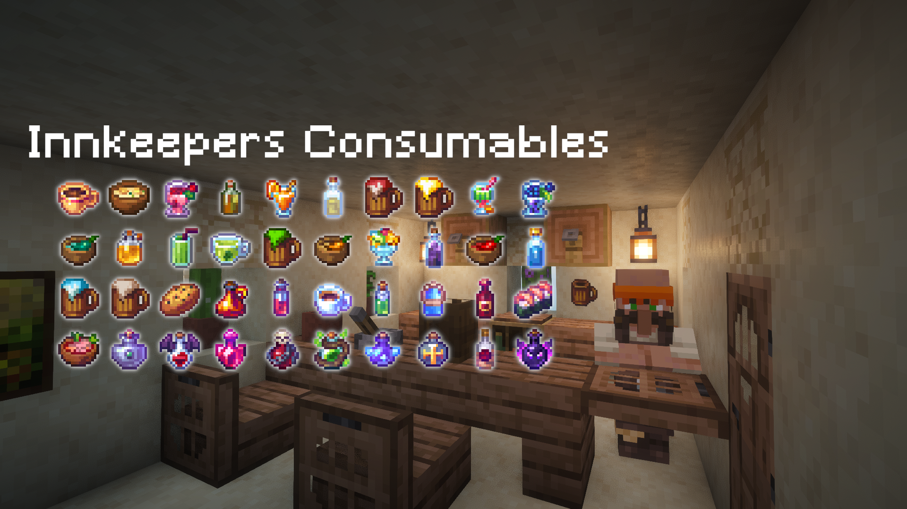

# Changelog

All notable changes to Loot & Explore are documented in this file.
The format is based on [Keep a Changelog](https://keepachangelog.com/en/1.1.0/).

## [1.1.1+1.21.1]

### Added

- Smithing recipes for the four themed Shields (shield + upgrade template + boss material), turned off when LNE Paladins is installed like the Maces

### Changed

- Frozen trial spawner loot tables moved to `spawners/frozen_depths/` like all other Frozen Depths tables: `spawners/frozen_depths/key`, `spawners/frozen_depths/ominous/key` and `spawners/frozen_depths/traps/all`

### Fixed

- Frozen Trial Spawners drop Frozen Keys and Monarch's Keys again, so the Frozen Vaults can be opened
- The Glacial Tomb uses its own loot: its ominous vault rolls `glacial_tomb/reward_ominous` and its hidden chests `glacial_tomb/hidden` instead of the Frost Tower and Castle tables
- The chest in the desert village inn is no longer empty
- Fixed compatibility issue with Serene Seasons: the Eternal Frostsiege snow no longer stops Serene Seasons from changing the weather rendering (GH Issue #17)

## [1.1.0+1.21.1]

The 1.21.1 rewrite: NeoForge support, a much bigger Frozen Depths, the Eternal Frostsiege raid and a complete relic overhaul.
Huge thanks to AnolXD for the new models, animations and textures, and to KaktusDoesMusic for the music.

### Added

- **NeoForge support** - relics use Curios on NeoForge and Trinkets on Fabric
- **Full themed arsenals** - the Ender Dragon, Wither, Glacial and Elder Guardian sets now each have a Sword, Axe, Mace, Shield, Bow and Crossbow with their own ability
  - Maces and Shields are skipped when LNE Paladins is installed, Bows and Crossbows when LNE Archers is installed
  - The Elder Guardian Bow and Crossbow shoot normally underwater (needs More RPG Library 2.8.3)
  - Small particles and a chime show when a weapon's ability is ready again (both can be turned off in the config)
- **Frozen Depths weapons** - Frost Haunt Axe, Frozen Bow, Guard's Frost Lance and the Monarch's Frost Staff, which shoots icicles and is crafted with the Monarch's Crown
  - With Spell Engine and Wizards you choose the staff's spell: Frostbolt or Icicle Barrage (icicles hover behind you and fly at the nearest enemies, more with projectile bonuses). It also has the Glacial Curse passive: spell hits can make icicles close in on the target from 4 sides
- **New Frozen Depths enemies** - Frozen Magician, Frozen Ranger, Monarch's Soldier, Monarch's Guard and Frost Hound
  - Four of them have a named **General** elite variant with extra abilities, for example General Ysmerith's Frost Blink and Frost Decoy
  - Magicians and Rangers kite you and look for open ground, Soldiers block with their shield
- **Monarch's Castle** - a new Frozen Depths structure with its own vaults and loot
- **Eternal Frostsiege** - a new raid in icy biomes
  - It starts by chance while you carry the Monarch's Crown, or right away when you throw Cryo Essence into a fire
  - Waves of Frozen Depths mobs pour out of Eternal Winter Portals that open around you. Higher difficulties add more waves and a General
  - Everyone who survives gets loot and experience
- **Music** by KaktusDoesMusic - the discs Frozen Depths, The King Cursed by Winter and Jolly Time, ambient music in the Glacial Tomb, Frost Towers and inns, and Frost Monarch battle music
- **New blocks**
  - Frozen decoration: Frozen Torch, Frozen Bones (a Frost Haunted can rise from them), Frozen Adventurer, Pointed Icicles, Icicle Bars, Fragile Ice and the Frozen Kingdom Flag
  - Crafting recipes for the frozen building blocks, like Blue Ice Bricks, Polished Ice, Frozen Chain and the Soulfrost Lantern
  - Sealed Monarch, Monarch's Crown and Frozen Soul Block for the Frost Monarch story
  - Cryotic Block, which lights into a freezing blue Frostflame
  - Deepslate and Icy Deepslate Bookshelves, Frozen Decorated Pots and Hanging Inn Signs in every wood type
  - Suspicious Bookshelves to brush, found in Frozen Depths structures, inns, strongholds, woodland mansions and village libraries
- **Empty Beer Mug** - left behind by the inn drinks, sold to Innkeepers and placeable as decoration
- **Cryo Essence** - dropped by Frozen Depths mobs, crafts into Cryotic Blocks
- **New consumables** - Mossflower Tea and Critical Strike support for Blackpepper Bread, Inferno Chilli Oil, Grilled Eel Sushi and the Phantomstrike Tonic
- **Explorer maps** - Expert Cartographers sell maps to the Monarch's Castle and the Glacial Tomb. Suspicious Bookshelves can hold maps to a Frost Tower (snowy villages, Outposts) or a Monarch's Castle (Frost Towers, Glacial Tombs)
- **New relic abilities** for every relic, with or without Spell Engine (for example Glacier Shard icicle bursts, Frozen Rib Frost Haunted allies and Poseidon's Amphora's last-stand ward)
- **Mod support** - Frozen Depths mobs cast Spell Engine spells, attack with Better Combat and roll with Combat Roll when those mods are installed, and are tagged for Frostiful
- **Config files** for weapon abilities, relic drops, relic bonuses and abilities, Frozen Depths mob stats and abilities, and the Frostsiege, plus `tweaks.json` to turn off relic bonuses, relic or weapon abilities, Spell Engine abilities, mob mod support, custom music and on-screen texts

### Changed

- **Frost Monarch** - fully remodeled with new abilities: ground icicles, Hailstorm, Ice Wall, Ice Barrier with Eternal Winter Portals and the Frost Screech
  - He now speaks, has a new awakening and death sequence and doesn't despawn mid-fight
  - His sounds, and the Glaze and Frozen Soul Block sounds, now come from their position and get quieter with distance
- **Icicles and frostballs** glow slightly in the dark, and the **Glaze** is surrounded by a small frost storm instead of a snowflake cloud
- **Ice sounds** - frostballs, ice walls, the Ice Barrier, portals and other ice effects use new ice sounds instead of breaking glass
- **Frost Haunted** (previously Frosthaunt) - remodeled with new animations and behavior. Existing Frosthaunts in old worlds are converted
- **Glacial Tomb** - larger, follows the terrain and is decorated with icicles
- **Frozen Depths structures** - each has its own placement and they spread out further. They stay away from villages, and the Glacial Tomb also from Ancient Cities
  - Every structure now has its own small set of naturally spawning Frozen Depths mobs
  - Bookshelves and pots inside them can hold extra loot
- **Frozen Vault and Frozen Trial Spawner** - ice themed particles. Ominous spawners now fire Frostballs, Slowness arrows and freezing clouds
- **Frost Resistance** - now also protects against Freezing and the other freezing effects
- **Relics**
  - No longer need Spell Engine
  - Work without a relic slot mod: bonuses apply in either hand, passive abilities work from the off hand (or the relic slot when Trinkets or Curios is installed), active abilities are used from the main hand
  - Tooltips show the real numbers for your current stats, and cooldowns show on the item
- **Creative menu** - the old tab is split into Generic Items & Blocks and Frozen Depths
- **On-screen texts** (boss lines, siege waves, relic zones) sit lower, closer to the hotbar. The height can be changed with `hud_text_height` in `config/loot_n_explore/client_v1.json`

### Removed

- `tweaks_v1.json` - relic drop chances now live in `relic_loot_v1.json`
