

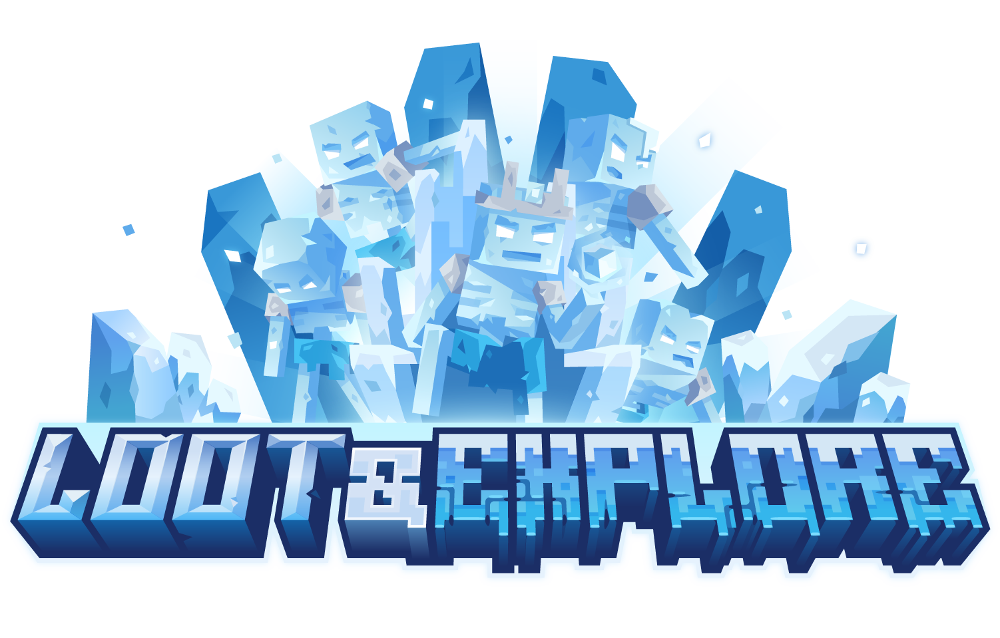
<h1>💎 Make exploration more fun & rewarding! </h1>
    

---

## 📂 Installation

### 🚨 Required Mods

<table>
<thead><tr><th>Mod</th><th>Download</th></tr></thead>
<tbody>
<tr><td><b>More RPG Library</b></td><td> </td></tr>
<tr><td><b>Structure Pool API</b></td><td> </td></tr>
</tbody></table>

### 👍 Highly Recommended / Compatibility Mods

<table><thead><tr><th>Mod</th><th>Compatibility Info</th><th>Download</th></tr></thead><tbody><tr><td><b>Spell Engine</b></td><td>Relics and weapons get Spell Engine spells and weapon skills</td><td> </td></tr><tr><td><b>Trinkets</b></td><td>Relic slot on Fabric</td><td> </td></tr><tr><td><b>Curios API</b></td><td>Relic slot on NeoForge</td><td> </td></tr><tr><td><b>Better Combat</b></td><td>Frozen Depths mobs use Better Combat attacks</td><td> </td></tr><tr><td><b>Combat Roll</b></td><td>Frozen Depths mobs can roll</td><td> </td></tr><tr><td><b>Witcher</b></td><td>More food and drinks in the loot chests</td><td> </td></tr><tr><td><b>Critical Strike</b></td><td>More food and drinks in the loot chests</td><td> </td></tr><tr><td><b>LNE Archers</b></td><td>Brings its own bows and crossbows for the boss weapon sets</td><td> </td></tr><tr><td><b>LNE Paladins</b></td><td>Brings its own maces and shields for the boss weapon sets</td><td> </td></tr></tbody></table>

---

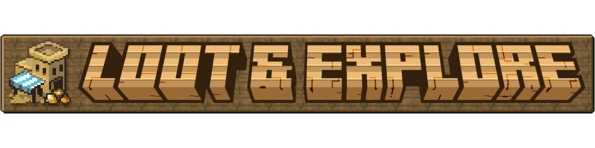

### 💎 Loot and Explore enhances your journey through Minecraft with cozy Inns to rest in, hidden loot and powerful Relics & Weapons. Dive into story-driven chapters with new structures, challenging dungeons and monsters.

---

## 🗺️ Exploration Content

### 🏚️ Take a rest, grab a drink and prepare for adventure at an Inn!
* Inns can be found around the Overworld, and small ones also appear in villages.
* Trade with the Innkeeper to receive food and drinks that buff you for a certain duration.

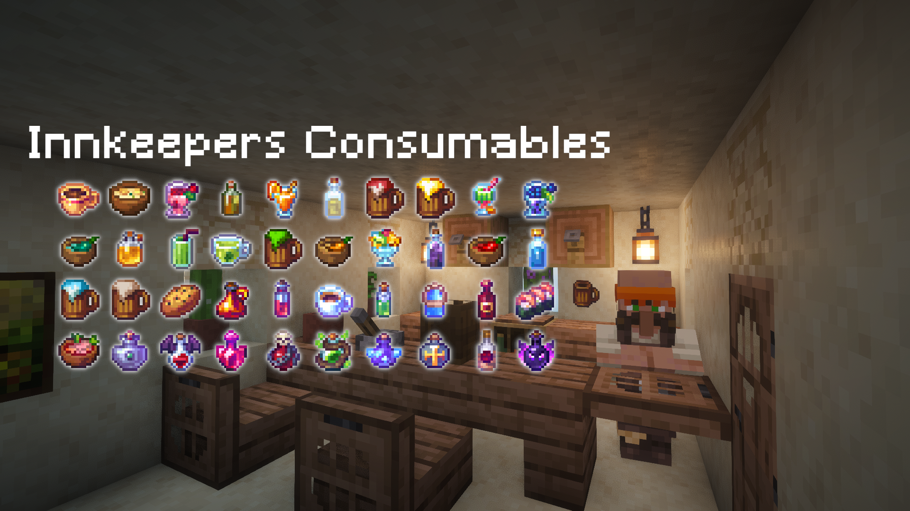

### 📖 Suspicious Bookshelves
* Suspicious Bookshelves are injected into Minecraft's structures, such as the Woodland Mansion and the Stronghold library.
* Brush the dust off these bookshelves to receive powerful loot, like enchanted books and spell scrolls (if Spell Engine content mods are installed).

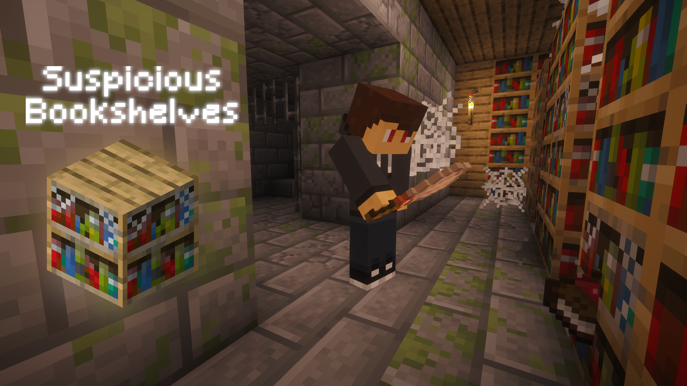

### ⚔️ Relics & Equipment
* Powerful relics with attribute bonuses and passive abilities are scattered around the world to encourage exploration.
* Relics can be crafted into themed Smithing Templates. Combine one with a strong relic dropped by a boss monster to craft a powerful weapon.
* Advancements and item tooltips guide you to where these items can be found.
* Themed weapons have been added to further reward Minecraft's existing exploration.
* All weapons have powerful passive abilities to reward your efforts.
* Weapons added by the RPG Series mods support upgrades!

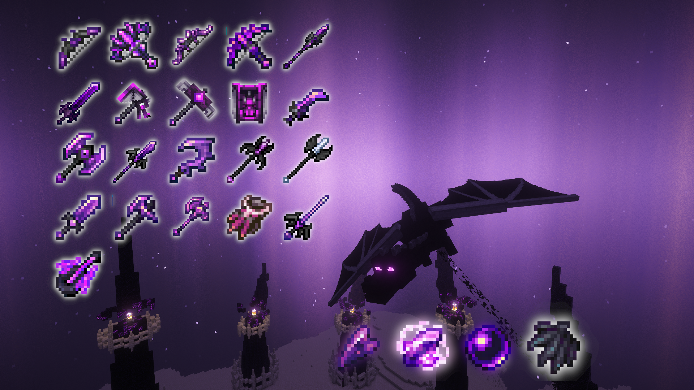

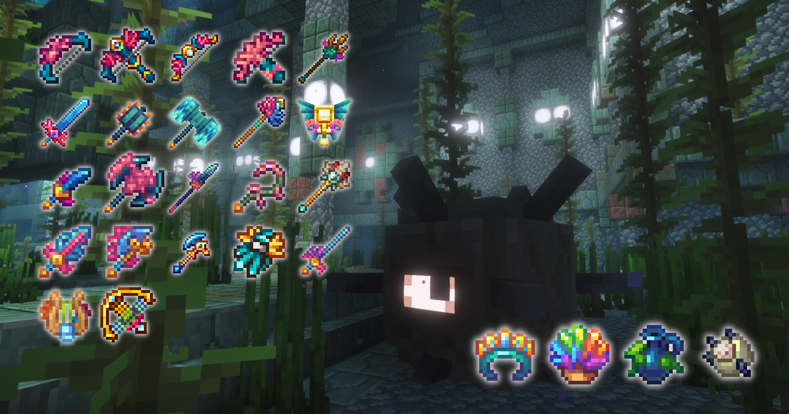

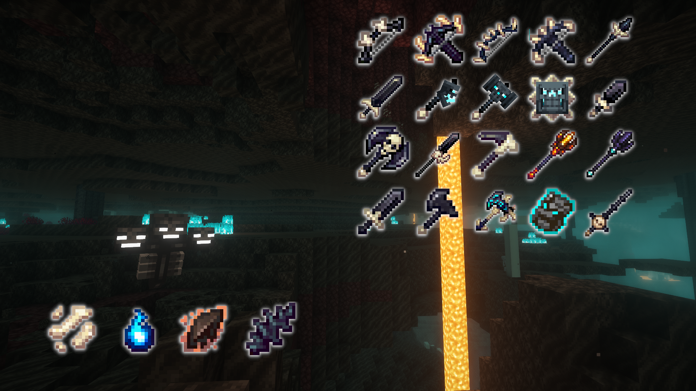

---

## 📜 Chapters

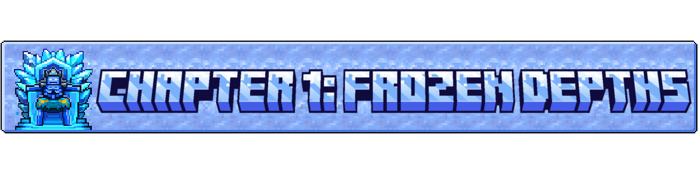

### ⚠️ Spoilers

#### 🧊 An ancient cold curse lies on these abandoned structures * Find challenging structures in cold biomes, filled with mindless cursed beings whose only goal is to kill everything alive. * Master frozen trials and earn keys to open frozen vaults for awesome rewards. * Explore the structures to find out who is responsible and how these poor beings fell under the curse of winter. * A wide range of new decorative blocks and items has been added. 
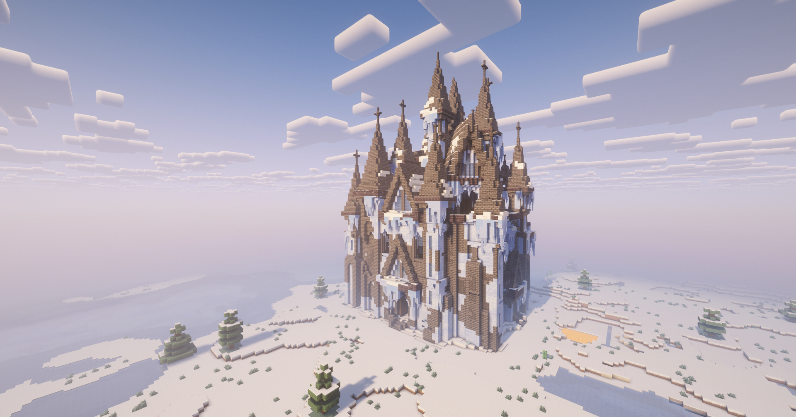
 #### 💀 Meet the monsters cursed by the cold! * 7 new frosty entities have been added to the game, each with their own challenging moveset. * 4 of them have a tougher Demi-Boss variant with enhanced abilities. * You can encounter them while traveling through the new structures or by starting a new event, the "Eternal Frostsiege". * The Eternal Frostsiege can be triggered by traveling through cold or icy biomes with a certain *cursed item*, or by burning *Cryo Essence* in a fire in these biomes. 
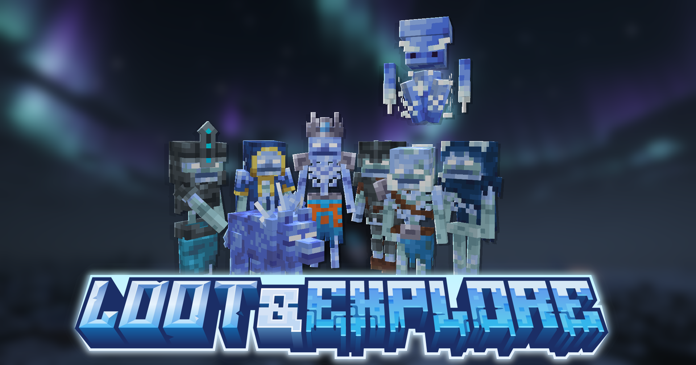
 #### ⚔️ Frozen Depths Equipment * A Glacial relic and weapon theme has been added for the Frozen Depths chapter. * These items come with cold abilities that freeze your foes and overwhelm them with the cold. 
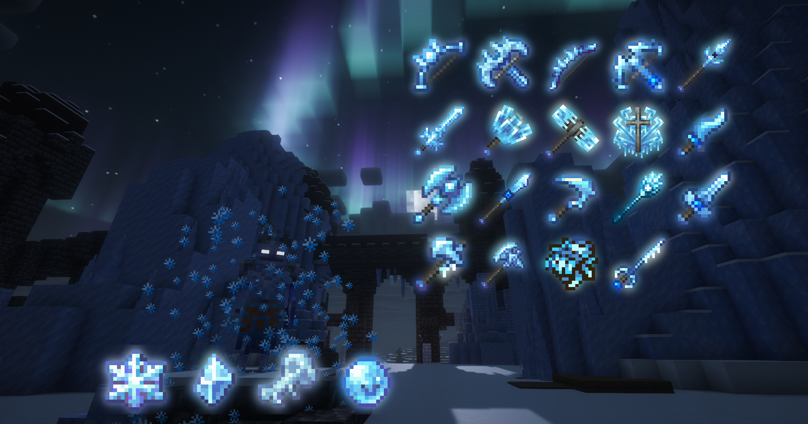
 #### 👑 The King Cursed by Winter * Who is the unknown king from the past who caused all these abandoned structures and cursed beings? * Where is he, and who cursed him? 
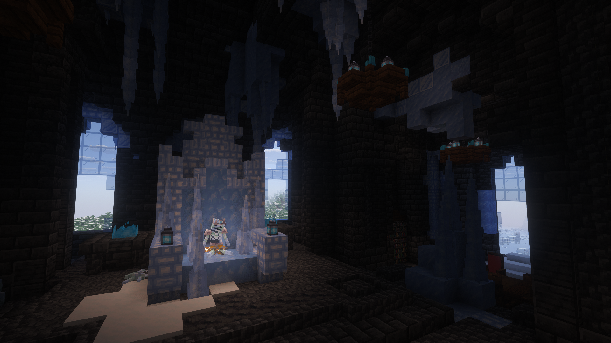

---

## 🧭 What Is Planned?
* More chapters with new structures, monsters and equipment themes.
* Quests for the Innkeeper that guide you to certain events and structures.
* More supported biomes and greater structure variety for Inns.
* Interactive lore blocks, events and a Lore Journal.

---

## ⚙️ Configuration

<table><thead><tr><th>Setting</th><th>File</th></tr></thead><tbody><tr><td>Tweaks (turn relic, weapon and mob features or the music off)</td><td><code>config/loot_n_explore/tweaks.json</code></td></tr><tr><td>Relics</td><td><code>config/loot_n_explore/relics_v2.json</code></td></tr><tr><td>Relic abilities</td><td><code>config/loot_n_explore/relic_abilities_v2.json</code></td></tr><tr><td>Relic loot</td><td><code>config/loot_n_explore/relic_loot_v1.json</code></td></tr><tr><td>Weapon abilities</td><td><code>config/loot_n_explore/weapon_abilities_v2.json</code></td></tr><tr><td>Weapon bonuses</td><td><code>config/loot_n_explore/equipment_v1.json</code></td></tr><tr><td>Equipment loot</td><td><code>config/loot_n_explore/loot_equipment_v1.json</code></td></tr><tr><td>Spell scroll loot</td><td><code>config/loot_n_explore/loot_scrolls.json</code></td></tr><tr><td>Status effects</td><td><code>config/loot_n_explore/effects_v2.json</code></td></tr><tr><td>Village inns</td><td><code>config/loot_n_explore/villages.json</code></td></tr><tr><td>Frozen Depths</td><td><code>config/loot_n_explore/frozen_depths/frozen_depths_v1.json</code></td></tr><tr><td>Frozen Depths mob attributes</td><td><code>config/loot_n_explore/frozen_depths/entity_attributes_v1.json</code></td></tr><tr><td>Eternal Frostsiege</td><td><code>config/loot_n_explore/frozen_depths/frostsiege.json</code></td></tr></tbody></table>

---

## 🙌 Credits

<table><thead><tr><th>Who</th><th>Contribution</th></tr></thead><tbody><tr><td>AnolXD</td><td>Created the models, animations and textures of the new Frozen Depths mobs</td></tr><tr><td>SeriousWorm</td><td>Created block textures and the first version of the Frost Monarch & Frost Haunted</td></tr><tr><td><a href="https://www.youtube.com/@KaktusDoesMusic">KaktusDoesMusic</a></td><td>Created the music discs and structure music</td></tr><tr><td>Damienbrittan</td><td>Created the awesome Modbanner.</td></tr><tr><td>Tobefriend (Rocket Studio)</td><td>Created the Icicle Models.</td></tr><tr><td><a href="https://emil.art/">Emil</a></td><td>Created the mod icons</td></tr><tr><td>CD Projekt Red</td><td>Created The Witcher 3, which inspired the Innkeeper villager</td></tr></tbody></table>

---

<h3>🧙‍♂️ Check out my other RPG-themed mods!</h3>
<table>
<tbody>
<tr><td align="center" style="text-align:center"></td><td align="center" style="text-align:center"></td><td align="center" style="text-align:center"></td></tr>
<tr><td align="center" style="text-align:center"></td><td align="center" style="text-align:center"></td><td align="center" style="text-align:center"></td></tr>
<tr><td align="center" style="text-align:center"></td></tr>
</tbody>
</table>

<h3>✨ Discover more of the RPG Series by Daedelus</h3>
<table>
<tbody>
<tr><td align="center" style="text-align:center"></td><td align="center" style="text-align:center"></td><td align="center" style="text-align:center"></td></tr>
<tr><td align="center" style="text-align:center"></td><td align="center" style="text-align:center"></td><td align="center" style="text-align:center"></td></tr>
<tr><td align="center" style="text-align:center"></td><td align="center" style="text-align:center"></td><td align="center" style="text-align:center"></td></tr>
</tbody>
</table>

<h3>🌟 More RPG content by other Spell Engine devs</h3>
<table>
<tbody>
<tr><td align="center" style="text-align:center"></td><td align="center" style="text-align:center"></td><td align="center" style="text-align:center"></td></tr>
</tbody>
</table>

---

💬 Questions, bugs or ideas? Join the <a href="https://discord.com/invite/AShKd5XrTu">Discord</a> or open an issue on <a href="https://github.com/ProfessorFichte/Loot-N-Explore/issues">GitHub</a>.

